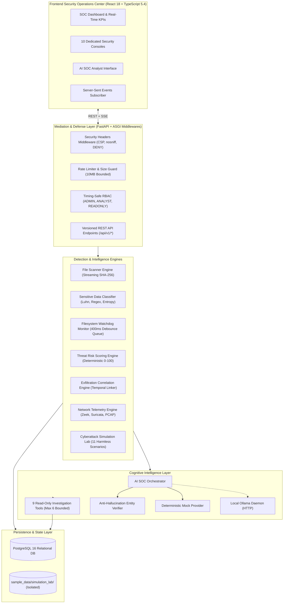

# SentinelDLP — AI-Powered Data Loss Prevention & Exfiltration Detection Platform

[](https://github.com/BULLET-USMAN/SentinelDLP/releases)
[](https://github.com/BULLET-USMAN/SentinelDLP)
[](https://www.python.org/)
[](https://fastapi.tiangolo.com/)
[](https://react.dev/)
[](https://www.typescriptlang.org/)
[](https://www.docker.com/)
[](LICENSE)
[](ci/github-actions-ci.yml)

---

## 1. Executive Overview

**SentinelDLP** is an enterprise-grade defensive cybersecurity platform designed to monitor authorized endpoint activity, discover and inventory corporate data assets, identify sensitive intellectual property, detect suspicious data exfiltration attempts, and provide AI-assisted security investigations for SOC teams.

Engineered across 12 structured phases, SentinelDLP combines low-level system telemetry (filesystem observer events, streaming cryptographic SHA-256 hashing, network log adapters) with high-level cognitive threat intelligence (explainable 0–100 risk scoring, temporal multi-signal correlation, and a privacy-preserving local AI SOC Analyst).

### Key Architectural Highlights
- **Zero-Leakage Privacy Redaction**: Streaming SHA-256 hashing (64 KB chunking), PCI-DSS Luhn validation, Shannon entropy secret detection, and automatic masking (`4532-••••-••••-1111`) before storage or display.
- **Explainable Threat Risk Engine**: Deterministic 0–100 threat score formulation based on the core philosophy: *"File sensitivity is context, not proof of malice."*
- **Multi-Signal Exfiltration Correlation**: Temporal correlation connecting sensitive file modifications, archive staging (`.zip`), and outbound egress telemetry.
- **Privacy-Preserving AI SOC Analyst**: Local LLM integration via Ollama (`llama3.2:3b`) with deterministic mock fallback, 9 bounded read-only tools, indirect prompt injection defenses, and database entity verification.
- **Cyberattack Simulation & Testing Lab**: 11 harmless, isolated scenarios evaluating detection precision, recall, and confusion matrix analytics against ground-truth benchmarks.
- **Production Hardening**: Timing-safe RBAC (`ADMIN`, `ANALYST`, `READONLY`), 10MB payload size limits, canonical path traversal defenses (CWE-22), and production deployment guards.

---

## 2. End-to-End System Architecture



---

## 3. Subsystem Maturity & Verification Matrix

SentinelDLP contains 12 fully verified subsystems backed by **171 automated pytest tests** and production TypeScript builds:

| Subsystem | Core Capabilities | Primary Tech | Automated Tests | Maturity Status |
|---|---|---|---|---|
| **Phase 1: Foundation** | Asynchronous API, PostgreSQL 16 ORM, Alembic migrations, Docker Compose | FastAPI / SQLAlchemy | 18 | `VERIFIED` |
| **Phase 2: File Scanner** | Streaming SHA-256 hashing (64 KB chunking), magic byte inspection, path traversal security | Python 3.12 / hashlib | 16 | `VERIFIED` |
| **Phase 3: Classifier** | PCI-DSS Luhn validation, PII detection, Shannon entropy secrets, zero-leakage masking | Regex / math / entropy | 22 | `VERIFIED` |
| **Phase 4: Monitoring** | Real-time filesystem observer, 400ms sliding-window debouncing, bounded queue (5,000), SSE | Watchdog / Starlette SSE | 18 | `VERIFIED` |
| **Phase 5: Threat Scoring**| Deterministic 0–100 scoring, 8 threat rules, 300s alert suppression, audit trails | Algorithmic scoring | 20 | `VERIFIED` |
| **Phase 6: Exfiltration** | Temporal multi-signal correlation, archive staging recognition, evidence modesty | Correlation engine | 20 | `VERIFIED` |
| **Phase 7: Network Telemetry**| Offline Zeek/Suricata log parsers, zero-payload pure-Python PCAP parser, 10 network rules | Multi-format parsers | 20 | `VERIFIED` |
| **Phase 8: SOC Dashboard**| Unified executive dashboard, global search (`Ctrl+K`), 10 security consoles | React 18 / Lucide | Frontend Spec | `VERIFIED` |
| **Phase 9: AI Analyst** | Deterministic mock + local Ollama, 9 bounded tools, anti-hallucination entity verification | Ollama / LangChain-like | 10 | `VERIFIED` |
| **Phase 10: Security Lab** | 11 harmless attack scenarios, confusion matrix analytics (100% precision/recall) | Isolated sandbox | 18 | `VERIFIED` |
| **Phase 11: Hardening** | Timing-safe RBAC, 10MB payload limit, ASGI security headers, canonical path check | ASGI Middleware | 15 | `VERIFIED` |
| **Phase 12: Release Eng.** | Release packaging, CI/CD, documentation suite, portfolio materials | GitHub Actions / Docs | 171 Total Tests | `PRODUCTION READY` |

---

## 4. Technical Portfolio & Documentation Suite

Detailed technical documentation and portfolio assets are available in the repository:

- 📋 **Executive Portfolio Overview**: [`docs/portfolio/project-overview.md`](docs/portfolio/project-overview.md)
- 📝 **Resume / CV Bullet Points**: [`docs/portfolio/cv-entry.md`](docs/portfolio/cv-entry.md)
- 💼 **LinkedIn Showcase Post**: [`docs/portfolio/linkedin-post.md`](docs/portfolio/linkedin-post.md)
- 🎥 **Demo Video Walkthrough Script**: [`docs/portfolio/demo-video-script.md`](docs/portfolio/demo-video-script.md)
- 📸 **UI Screenshot Capture Guide**: [`docs/portfolio/screenshot-guide.md`](docs/portfolio/screenshot-guide.md)
- 🏗️ **Complete System Architecture**: [`docs/architecture/system-architecture.md`](docs/architecture/system-architecture.md)
- 🧪 **Detection Validation Report**: [`docs/testing/detection-validation-report.md`](docs/testing/detection-validation-report.md)
- 🪟 **Windows 11 Setup Guide**: [`docs/installation/windows-11-setup.md`](docs/installation/windows-11-setup.md)
- 🐳 **Docker Deployment Guide**: [`docs/deployment/docker-deployment.md`](docs/deployment/docker-deployment.md)
- 🚀 **v1.0.0 Release Notes**: [`RELEASE_NOTES.md`](RELEASE_NOTES.md)
- 🤝 **Contributing Guidelines**: [`CONTRIBUTING.md`](CONTRIBUTING.md)
- 🔮 **Future Development Roadmap**: [`FUTURE_ROADMAP.md`](FUTURE_ROADMAP.md)

---

## 5. Quick Start (Windows 11 & Docker)

### Option A: Local Windows 11 PowerShell Setup

```powershell
# 1. Clone the repository
git clone https://github.com/BULLET-USMAN/SentinelDLP.git
cd SentinelDLP

# 2. Configure environment
Copy-Item .env.example .env

# 3. Setup Python virtual environment
python -m venv .venv
.\.venv\Scripts\Activate.ps1
pip install -r backend/requirements.txt

# 4. Setup React frontend
cd frontend
npm install
cd ..

# 5. Run the full automated test suite (171 tests)
.\.venv\Scripts\python.exe -m pytest -q

# 6. Launch both Backend & Frontend with one script
.\scripts\run_local.ps1
```

Once running:
- **SOC Executive Dashboard**: [http://localhost:5173](http://localhost:5173)
- **AI SOC Analyst Console**: [http://localhost:5173/ai-analyst](http://localhost:5173/ai-analyst)
- **Security Testing Lab**: [http://localhost:5173/security-lab](http://localhost:5173/security-lab)
- **API Swagger Documentation**: [http://127.0.0.1:8000/docs](http://127.0.0.1:8000/docs)
- **System Health Probe**: [http://127.0.0.1:8000/health/live](http://127.0.0.1:8000/health/live)

### Run the Interactive Portfolio Demonstration Tour
```powershell
.\scripts\run_demo.ps1
```

### Option B: Docker Compose Deployment

```powershell
# Build and run containers in detached mode
docker compose up -d --build

# Verify container health
docker compose ps

# Run migrations
docker compose exec backend alembic upgrade head
```

---

## 6. Defensive Philosophy & Technical Boundaries

SentinelDLP adheres to uncompromising honesty regarding telemetry boundaries:
1. **Observer Telemetry Modesty**: Filesystem events capture creation, modification, movement, and deletion. Without proprietary kernel-level filter drivers (e.g. Windows Minifilter or Linux eBPF), SentinelDLP records `event_source="watchdog"` and does not fabricate process PIDs or user credentials.
2. **Container Isolation & Packet Capture**: In containerized environments, promiscuous live packet capture is restricted by the container boundary. SentinelDLP surfaces this as a `VISIBILITY_GAP` and provides robust offline log and PCAP header parsing.
3. **Forensic Modesty**: Exfiltration event correlation tags links as `circumstantial` or `temporal` unless deterministic evidence proves byte-for-byte stream egress.
4. **AI Hallucination Defense**: All AI-generated references are strictly verified against live database entity IDs; ungrounded citations are removed prior to SOC analyst review.

---

## 7. Project Roadmap & Versioning

- **[x] Phase 1: Project Foundation, Backend Architecture & Development Environment** (`v0.1.0`)
- **[x] Phase 2: Intelligent File Scanning Engine & File Inventory System** (`v0.2.0`)
- **[x] Phase 3: Advanced Sensitive Data Detection & Classification Engine** (`v0.3.0`)
- **[x] Phase 4: Real-Time File Activity Monitoring & Security Event Collection** (`v0.4.0`)
- **[x] Phase 5: Intelligent Threat Risk Scoring, Detection Rules & Security Alert Engine** (`v0.5.0`)
- **[x] Phase 6: Advanced Data Exfiltration Detection & Security Event Correlation Engine** (`v0.6.0`)
- **[x] Phase 7: Advanced Network Traffic Monitoring, Detection Engineering & Threat Intelligence** (`v0.7.0`)
- **[x] Phase 8: Enterprise Security Operations Center Dashboard & Unified Security Intelligence** (`v0.8.0`)
- **[x] Phase 9: AI-Powered SOC Analyst, Local LLM Integration & Intelligent Security Investigation** (`v0.9.0`)
- **[x] Phase 10: Advanced Cyberattack Simulation, Detection Validation & Security Testing Laboratory** (`v0.10.0`)
- **[x] Phase 11: Advanced Security Hardening, Vulnerability Assessment & Performance Optimization** (`v0.11.0`)
- **[x] Phase 12: Final Release Engineering, Deployment Packaging, Documentation & Professional Cybersecurity Portfolio** (`v1.0.0`)
- **[ ] Phase 13: Enterprise Multi-Tenancy & Fleet Orchestration** (`v1.1.0` — Planned)
- **[ ] Phase 14: Automated Quarantine & Defensive Response Engine** (`v1.2.0` — Planned)

---

## 8. License

This project is licensed under the **MIT License** — see the [LICENSE](LICENSE) file for details.
