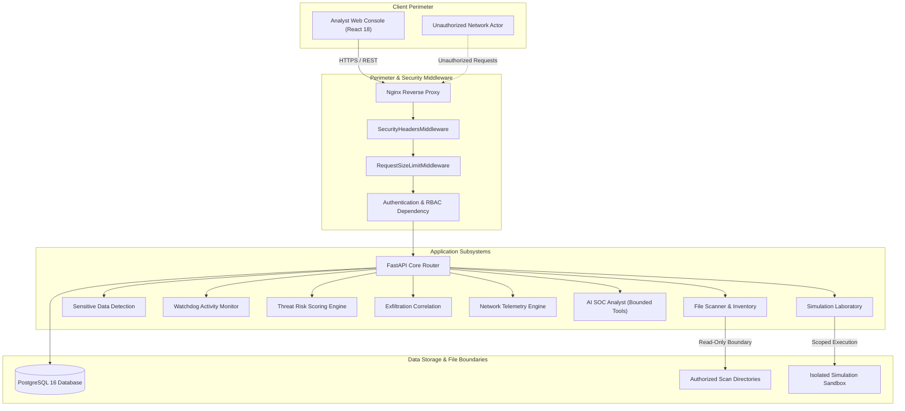

# SentinelDLP — Phase 11: Security Hardening & Vulnerability Assessment
## Architecture, Threat Model & Hardening Specifications

**Status:** Phase 11 Active  
**Baseline Tests:** 156 passing tests across Phases 1–10  

---

## 1. Executive Summary

This specification establishes the Phase 11 security hardening, vulnerability assessment, and performance optimization architecture for SentinelDLP. SentinelDLP is a defensive cybersecurity platform that processes endpoint file activity, performs cryptographic hashing and sensitive classification, correlates exfiltration patterns, and provides an AI SOC Analyst with controlled evidence-gathering tools.

---

## 2. STRIDE Threat Model

### STRIDE Assessment Summary

1. **Spoofing**: Addressed via Token / API-Key authentication dependency enforcing roles (`ADMIN`, `ANALYST`, `READONLY`) with timing-safe comparison.
2. **Tampering**: All mutation endpoints (alert acknowledgments, status changes, notes, simulation runs) require `ADMIN` or `ANALYST` role permissions.
3. **Repudiation**: Authenticated user identity is captured in audit logs and mutation events (`AlertAuditLog`, `SystemAuditRecord`).
4. **Information Disclosure**: Sensitive endpoints (`/detection/findings`, `/ai/investigations`) are protected by authentication; security headers prevent MIME-sniffing and clickjacking.
5. **Denial of Service**: Request payload size limit middleware (max 10MB default) and rate limiting protect against memory exhaustion.
6. **Elevation of Privilege**: Path boundaries are enforced in network ingestion (`validate_path_within_boundary`) and simulations are blocked in production environments.
