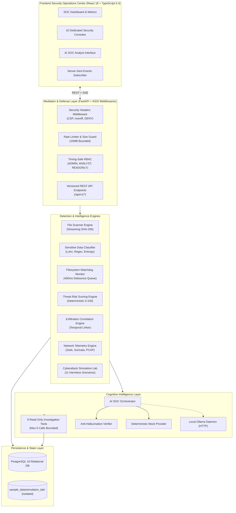
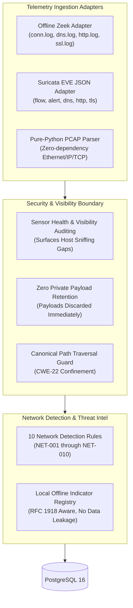
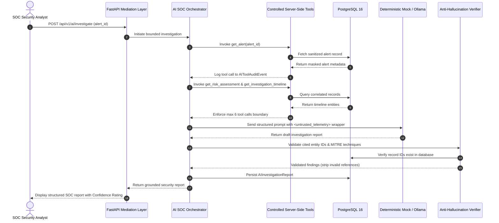

# SentinelDLP — System Architecture Specification (v1.0.0)

This document provides a comprehensive architectural reference for **SentinelDLP**, an AI-powered Data Loss Prevention and Exfiltration Detection Platform.

---

## 1. System Overview Architecture

SentinelDLP follows a modular, defense-in-depth architecture dividing responsibilities across presentation, API mediation, detection intelligence, background workers, and persistent relational storage.

---

## 2. Telemetry Processing & Detection Pipeline

Every filesystem and network event traverses a multi-stage deterministic pipeline before surfacing as a prioritized SOC alert.

```mermaid
flowchart LR
    EventIn["Filesystem / Network Event"] --> Debounce["Debouncer & Deduplicator\n(0.4s Window)"]
    Debounce --> BoundedQ["Thread-Safe Queue\n(5,000 Capacity)"]
    BoundedQ --> Worker["Asynchronous Event Worker"]
    Worker --> Extract["Content Extraction & Hashing\n(Streaming SHA-256)"]
    Extract --> Classify["Content Inspection\n(Luhn / Regex / Entropy)"]
    Classify --> Redact["Zero-Leakage Redaction\n(Masking at Rest)"]
    Redact --> RiskEval["Deterministic Threat Scoring\n(0-100 Scoring Model)"]
    RiskEval --> ExfilCorr["Temporal Exfiltration Correlation\n(Staging + Transfer)"]
    ExfilCorr --> AlertGen["Alert Lifecycle & Sliding Suppression\n(300s Deduplication)"]
    AlertGen --> SOCView["Enterprise SOC Stream & SSE Push"]
```

---

## 3. Network Telemetry Ingestion Architecture

SentinelDLP accepts normalized security telemetry from industry-standard network sensors while respecting container and OS boundaries:

---

## 4. AI SOC Analyst Investigation & Verification Sequence

The AI SOC Analyst operates strictly under a read-only, audited, and anti-hallucination execution sequence:

---

## 5. Defensive Security Boundaries & Modesty Taxonomy

### Telemetry Provenance Taxonomy
All security evidence collected or inferred is tagged with explicit provenance:
1. `OBSERVED`: Directly captured by an active local sensor (e.g. Watchdog filesystem event, parsed PCAP header).
2. `IMPORTED`: Parsed from external sensor log exports (e.g. Zeek `conn.log`, Suricata `eve.json`).
3. `LAB_SIMULATED`: Synthetically generated inside the isolated attack testing laboratory.
4. `INFERRED`: Derived algorithmically via temporal correlation or secondary rule weights.

### Causal Modesty in Exfiltration Detection
When SentinelDLP correlates file creation with outbound transfer activity:
- It tags relationships as `temporal` or `circumstantial`.
- It explicitly disclaims deterministic claims of file content exfiltration unless direct payload byte hashes match remote socket streams.

### Isolation & Sandboxing Confinement
- The Cyberattack Simulation Lab operates strictly inside `sample_data/simulation_lab/`.
- Attempts to target files outside this boundary are rejected with canonical path errors.
- Simulation execution is blocked in production environments by default (`ENVIRONMENT=production`).
