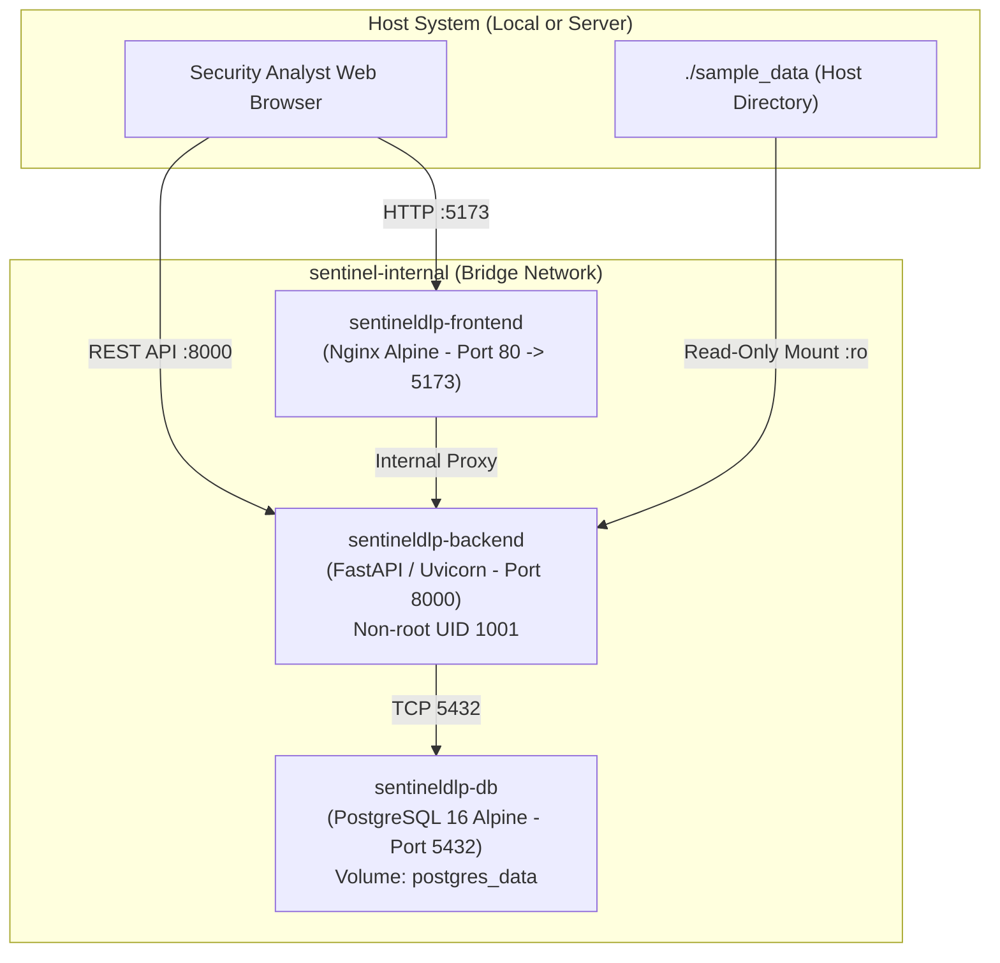

# SentinelDLP — Docker Deployment & Container Architecture Guide

This document describes the multi-container production-style deployment architecture for **SentinelDLP v1.0.0** using Docker and Docker Compose.

---

## 1. Container Architecture Overview

The SentinelDLP container environment segregates concerns across three tightly isolated services running on an internal bridge network (`sentinel-internal`):



---

## 2. Container Security Boundaries

1. **Least-Privilege Execution**:
   - The backend container runs as a dedicated non-root user `sentinel` (UID 1001, GID 1001).
   - The frontend container uses an unprivileged Nginx process.
2. **Read-Only Data Mounts**:
   - Telemetry sample directories (`./sample_data`) are mounted into the backend container with read-only (`:ro`) permissions to prevent tampering.
3. **Database Network Isolation**:
   - PostgreSQL 16 binds strictly to `127.0.0.1:5432` on the host, preventing unsolicited external network exposure.
4. **Container Telemetry Modesty (Sensor Visibility Disclosure)**:
   - When running inside Docker containers, promiscuous host-level network packet capture is restricted by the container isolation boundary.
   - SentinelDLP documents this as a `VISIBILITY_GAP` on the sensor status page and provides offline Zeek/Suricata log ingestion and PCAP header parsing.

---

## 3. Deployment Instructions

### Prerequisites
- Docker Engine 24.0+
- Docker Compose v2.20+
- At least 4 GB available system RAM

### Step 1: Clone Repository & Configure Environment
```bash
git clone https://github.com/BULLET-USMAN/SentinelDLP.git
cd SentinelDLP
cp .env.example .env
```

### Step 2: Build and Start Containers
```bash
docker compose up -d --build
```

### Step 3: Verify Container Health
```bash
docker compose ps
```
**Expected Output:**
```
NAME                    IMAGE                   COMMAND                  SERVICE             STATUS
sentineldlp-db          postgres:16-alpine      "docker-entrypoint.s…"   db                  Up (healthy)
sentineldlp-backend     sentineldlp-backend     "/entrypoint.sh"         backend             Up
sentineldlp-frontend    sentineldlp-frontend    "/docker-entrypoint.…"   frontend            Up
```

### Step 4: Run Database Migrations Inside Container
```bash
docker compose exec backend alembic upgrade head
```

---

## 4. Operational Management

### Viewing Live Logs
```bash
# Stream all logs
docker compose logs -f

# View backend API logs only
docker compose logs -f backend
```

### Probing Subsystem Health
```bash
# Process liveness
curl http://localhost:8000/health/live

# Dependency readiness
curl http://localhost:8000/health/ready
```

### Stopping the Services
```bash
# Stop containers (preserves database volume)
docker compose down

# Stop and wipe database volume (clean reset)
docker compose down -v
```

---

## 5. Production Hardening Checklist

When transitioning from local evaluation to production Docker deployment:
- [ ] Set `ENVIRONMENT=production` in `.env`.
- [ ] Replace default database passwords with cryptographically secure strings (e.g. `openssl rand -hex 24`).
- [ ] Configure `ALLOWED_ORIGINS` to match your enterprise domain (e.g. `https://dlp.corp.internal`).
- [ ] Provision SSL/TLS certificates via reverse proxy (Traefik, Nginx, or AWS ALB).
- [ ] Set `DEBUG=false` to ensure production safety guards block attack simulation execution.
